# 👋 ¡Hola! Soy **Angel Rafael Gonzalez**

🎓 **Estudiante de Ingeniería en Sistemas de la Información (UTN)**  
⚙️ **SysAdmin** | 🚀 **Orientado a DevOps, Infraestructura y Redes**

---

## 🔧 Sobre mí

Especializado en la administración de infraestructura, virtualización, redes y automatización de sistemas. Mi enfoque está centrado en garantizar la alta disponibilidad, observabilidad y seguridad de los entornos IT, combinando la gestión de servidores con el desarrollo de scripts y herramientas internas de automatización.

- 🏢 **Experiencia en:** Administración de Windows Server, Active Directory, Proxmox VE, Grafana y SQL Server.
- ⚡ **Automatización:** Desarrollo de scripts y herramientas con Python, PowerShell, Batch y APIs de gestión.
- 🌐 **Redes y Protocolos:** TCP/IP, DNS, DHCP, VPN, SMB, RDP, WRM.
- 💡 **Intereses:** Cultura DevOps, CI/CD, Infraestructura como Código (IaC) y Cloud Computing.

---

## 🛠️ Proyectos destacados

### CAT · TeamViewer Sync

Herramienta que construí para automatizar el alta y el mantenimiento de terminales en **TeamViewer** a partir de los correos de texto plano que llegan con los cambios.

- 🎯 **Problema:** aplicar a mano esas listas era lento y propenso a errores (grupos mal escritos, números duplicados, equipos reemplazados).
- ✅ **Solución:** la persona pega el correo, revisa una tabla (lo inválido se marca en **rojo**) y un **motor de reglas** aplica los cambios en TeamViewer. Si algo es riesgoso, **no lo toca** y pide revisión manual.
- 🔒 **Seguro por diseño:** falla cerrado, modo simulación, contraseña obligatoria para exponerlo en red y cola revalidada como no confiable.
- 🧪 **Calidad:** 100 pruebas automatizadas, CI y auditorías de seguridad sin hallazgos.

  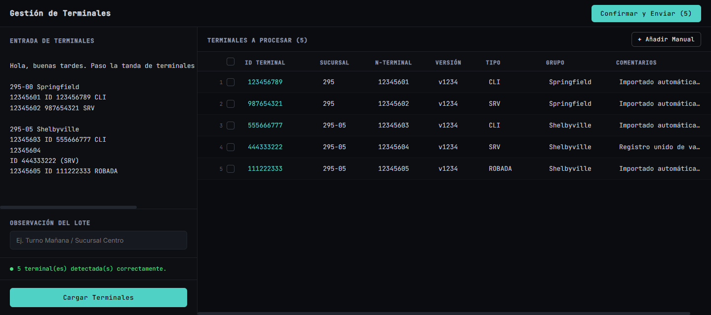
  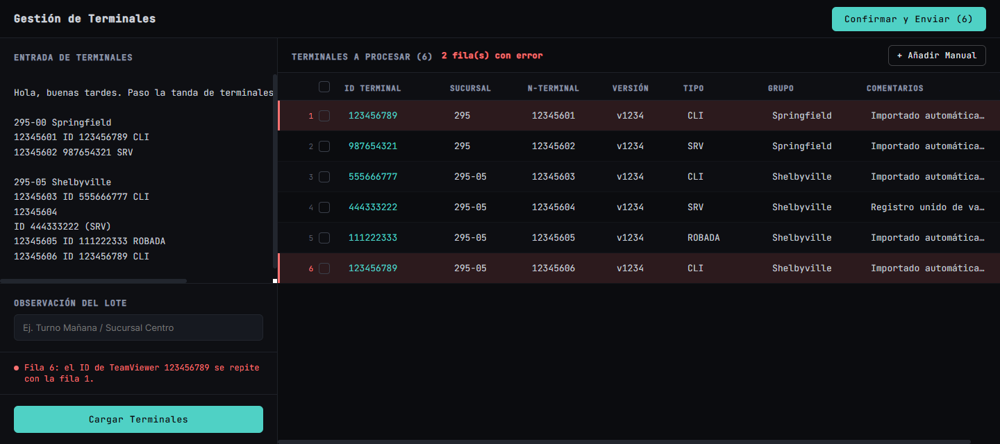

**Stack:** Python · FastAPI · React + Vite · GitHub Actions · APIs de TeamViewer y GitHub

### SEP Update · Distribución de firmas Symantec

Herramienta que construí para descargar las definiciones de **Symantec Endpoint Protection** y distribuirlas a los servidores SEPM de varias sedes por **WinRM HTTPS**, sin intervención manual.

- 🎯 **Problema:** actualizar cada sede a mano era lento y perdiamos mucho tiempo.
- ✅ **Solución:** un script detecta la última versión, la descarga una sola vez y la entrega a cada sede. Lleva el estado **por archivo y por servidor**: si una sede falla, la próxima vuelta reintenta solo esa.
- 🔒 **Seguro por diseño:** validación TLS completa, **SHA256 verificado en destino** antes de activar cada archivo, y huella de certificado confirmada antes de confiar en una sede.
- 🧪 **Calidad:** 21 pruebas automatizadas que simulan una sede real, códigos de salida por tipo de fallo y logs JSON para Grafana.

**Cómo se comporta cuando una sede falla.** En la primera vuelta, dos sedes reciben el archivo y la tercera no responde: el script lo registra, termina con error y deja esa sede pendiente.

  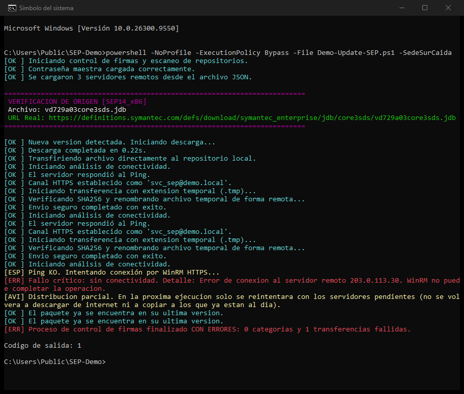

En la transferencia siguiente no vuelve a descargar ni a copiar a las sedes que ya están al día: entrega solo a la pendiente y recién entonces da el archivo por distribuido.

  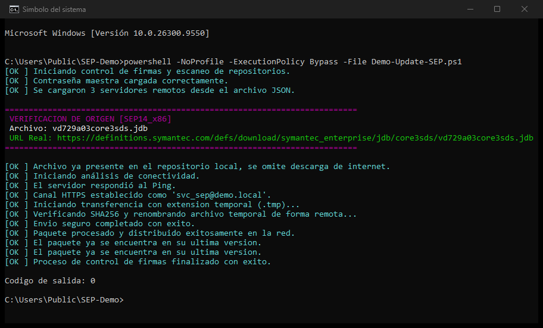

Capturas de la consola ejecutando el script contra servidores simulados.

**Monitoreo en Grafana.** Cada ejecución deja logs JSON que Grafana Alloy envía a Loki; un dashboard muestra en vivo las transferencias exitosas, la disponibilidad de los servidores, los errores y el historial de entregas por sede.

  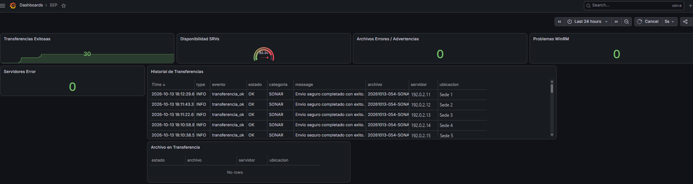

Dashboard real; las IPs y los nombres de las sedes fueron reemplazados.

**Stack:** PowerShell 5.1 · WinRM HTTPS · Pester · Grafana Alloy · Loki

### ConfigTerminal · Provisioning y bloqueo de terminales Windows

Herramienta que construí para dejar una terminal tipo casino web puesta en marcha: captura la configuración de un equipo modelo y la clona en cada terminal nueva.

- 🎯 **Problema:** preparar cada terminal a mano (aspecto, directivas, energía, privacidad, drivers, nombre, inicio automático) eran decenas de pasos repetidos y fáciles de olvidar.
- ✅ **Solución:** un script captura el equipo modelo (registro, directivas de grupo, firewall, energía, servicios, barra de tareas) y lo aplica a la terminal nueva; lo que Windows ya no expone por registro lo resuelve manejando la app de Configuración por **automatización de interfaz (UI Automation)**.
- 🔒 **Seguro por diseño:** backup del estado previo, inicio de sesión automático vía LSA cifrado, tolerante a fallos (si una clave está protegida, sigue y lo informa) y con chequeo de precondiciones antes de aplicar.
- 🧪 **Calidad:** importación de registro valor por valor, resumen final tipo checklist que **verifica el estado real** del equipo, y un registro por terminal.

  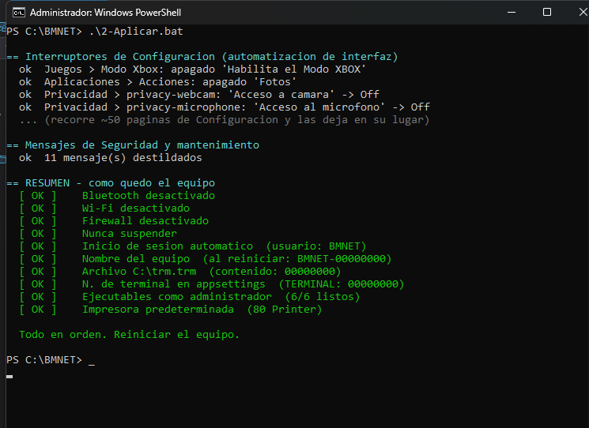

Al terminar **verifica el estado real** del equipo. Lo que quedó pendiente lo marca en amarillo —acá la impresora todavía no está instalada— en vez de darlo por hecho.

  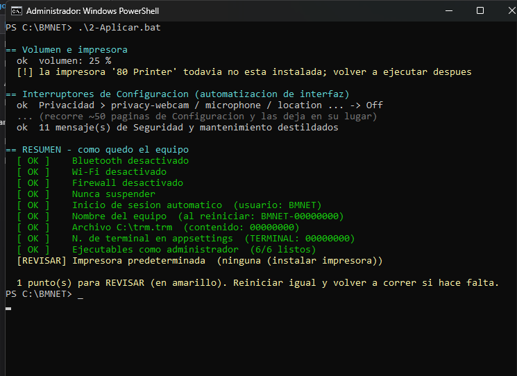

Capturas de la consola ejecutando el script (datos de ejemplo).

**Stack:** PowerShell 5.1 · UI Automation (.NET) · Registro y Directivas de Windows · robocopy

### Backups bare metal · UrBackup

Implementé copias de seguridad de **imagen completa** de los puestos de trabajo de la empresa con **UrBackup**, para poder restaurar un equipo entero —sistema, programas, configuración y datos— después de una falla de disco o un ransomware.

- 🎯 **Problema:** cuando un puesto fallaba había que reinstalar y configurar todo desde cero, y lo que no estaba guardado en un servidor se perdía.
- ✅ **Solución:** un servidor UrBackup respalda todos los equipos que lo necesitan y guarda las imágenes en un NAS: **incremental cada 5 días y completa cada 30**, con retención automática y *change block tracking* para que las incrementales solo copien lo que cambió.
- 🔁 **Restauración probada:** recuperación completa de un equipo arrancando desde la ISO de rescate de UrBackup (*bare metal restore*).
- 🧹 **Automatización:** script propio (Batch + PowerShell) que, al dar de baja un usuario, comprueba que no haya copias en curso y libera su espacio en el momento, sin esperar las 24 horas de la limpieza automática.

  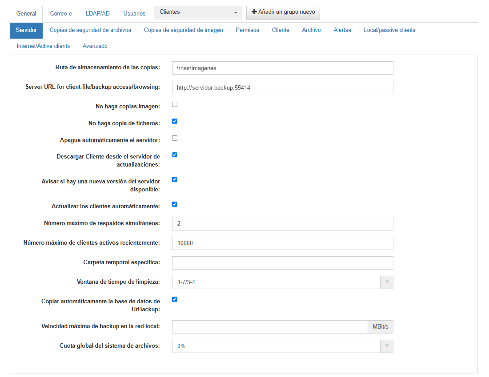
  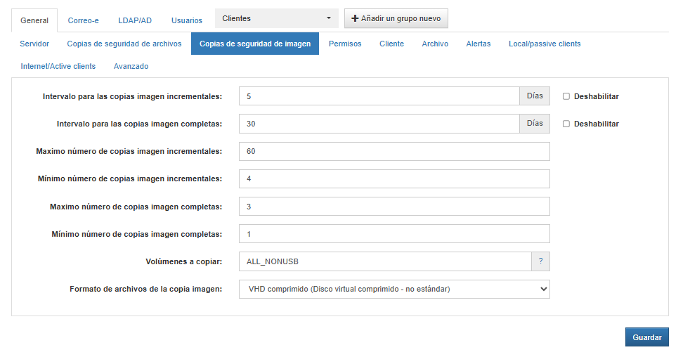

  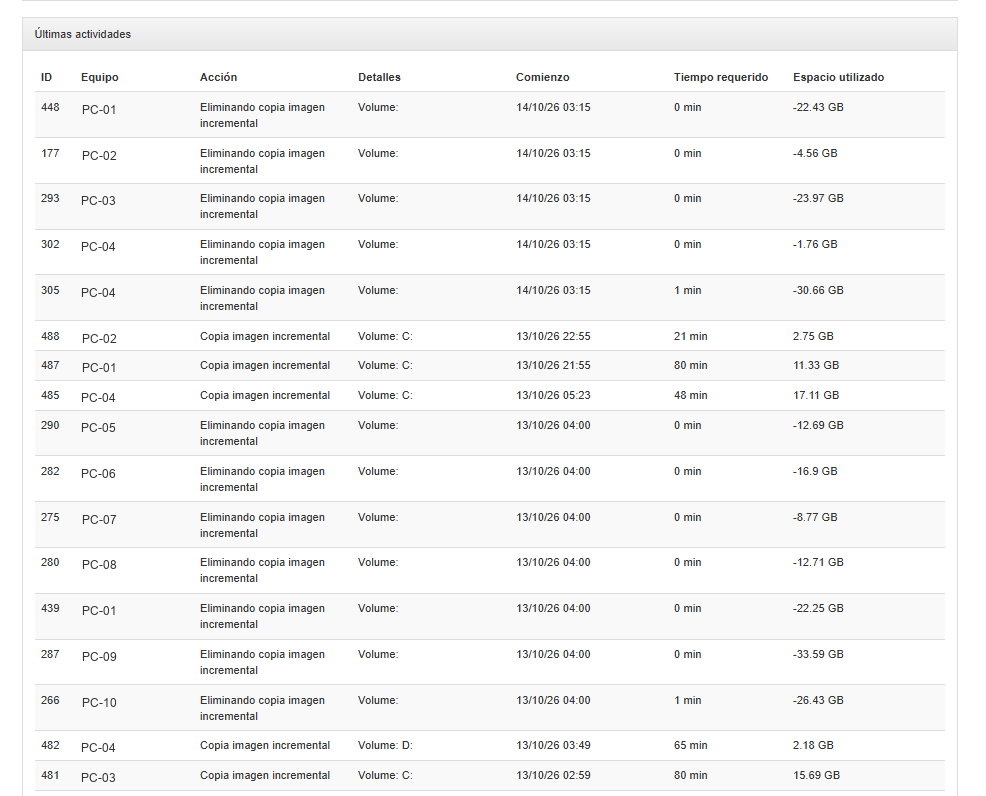
  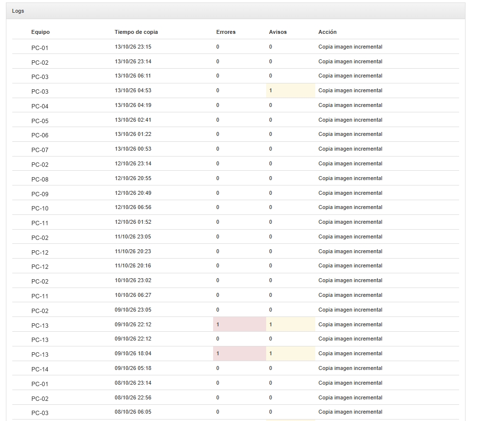

Capturas del panel real; los nombres de equipos, la IP y el nombre del servidor fueron reemplazados.

**Stack:** UrBackup · Windows · NAS (SMB) · PowerShell · Batch

---

## 🚀 Tecnologías y herramientas

### 🖥️ Sistemas, Virtualización y Servidores

  &nbsp;&nbsp;
  &nbsp;&nbsp;
  

### ⚡ Automatización, Scripting y Desarrollo

  &nbsp;&nbsp;
  &nbsp;&nbsp;
  &nbsp;&nbsp;
  &nbsp;&nbsp;
  

### 📊 Observabilidad, Monitoreo y Control de Versiones

  &nbsp;&nbsp;
  &nbsp;&nbsp;
  

### 🗄️ Bases de datos y Almacenamiento

  &nbsp;&nbsp;
  &nbsp;&nbsp;
  

---

## 📫 Contacto

✉️ **Email:** rafa2005gz@gmail.com  
💼 **LinkedIn:** [linkedin.com/in/angel-rafael-gonzalez-96a39a2ba](https://www.linkedin.com/in/angel-rafael-gonzalez-96a39a2ba)
