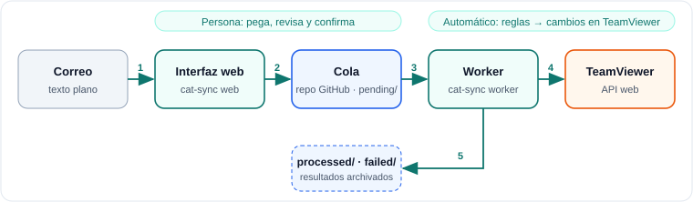

# CAT · TeamViewer Sync

> De un correo en texto plano a TeamViewer, con reglas explícitas, modo simulación y sin sorpresas.

## El problema

Las terminales que había que dar de alta o modificar en TeamViewer llegaban **por correo, en texto
plano**, una línea por terminal y con el formato que cada persona prefería. Aplicarlas a mano era
lento y propenso a errores: un grupo mal escrito, un número duplicado o una terminal *reemplazada*
(ID de TeamViewer nuevo, mismo número de terminal) dejaban la libreta de direcciones inconsistente.

## La solución

CAT automatiza el trabajo repetitivo **sin quitar a la persona del circuito**:

1. **Interpreta** el correo que se pega en una interfaz web (sucursal, terminal, ID, versión, tipo, grupo).
2. **Revisa**: la persona corrige en una tabla editable; el sistema valida y marca en **rojo** lo que está mal.
3. **Encola**: el lote confirmado se guarda como JSON en un repositorio privado de GitHub.
4. **Aplica**: un proceso automático lee la cola y un **motor de reglas** decide qué hacer con cada
   terminal: crear, renombrar, mover, reemplazar, o pedir revisión manual.

## Lo que más cuidé en el diseño

- **Motor de reglas puro y probado.** 9 reglas explícitas (R100 a R401), cada una con su prueba. Si el
  número de terminal ya está *online* en otra máquina, **se detiene** y pide revisión manual: nunca
  le quita el control a un equipo en uso.
- **Falla cerrado.** Si TeamViewer no responde, no se aplica nada y el lote espera. La primera versión
  trataba un error como «lista vacía», y eso provocaba altas duplicadas.
- **Modo simulación.** `--dry-run` y `--file` muestran qué haría el programa antes de tocar nada.
- **Errores visibles.** Las filas inválidas se marcan en rojo, con su número y un mensaje en español.
- **Trazabilidad.** Cada terminal queda con su resultado (regla, acción, estado, mensaje) en el
  lote archivado.

## Seguridad

Pensado para dejarlo en una VM y abrirlo solo cuando se necesita:

- La web escucha solo en el propio equipo; **para exponerla en red exige contraseña** y no arranca sin ella.
- Lista de `Host` permitidos, `Content-Security-Policy` y demás cabeceras de seguridad.
- El worker **revalida cada registro de la cola** como no confiable.
- Secretos fuera del código y de los logs; entradas validadas (incluye bloqueo de inyección en logs).
- Auditoría limpia: `pip-audit`, `npm audit` y `bandit` sin hallazgos.

## Calidad

- **100 pruebas automatizadas**, sin acceso a red ni a cuentas reales.
- **CI** en GitHub Actions: estilo (`ruff`, `eslint`), pruebas, compilación y auditorías de seguridad.
- Decisiones de diseño documentadas (ADR) y documentación en español e inglés.

## Stack

`Python` · `FastAPI` · `React` + `Vite` · `GitHub Actions` · API web de `TeamViewer` · API de `GitHub`
(como cola de mensajes) · `pytest` · `ruff` · `bandit`

## Documentación

| Documento | Para quién |
|-----------|------------|
| [Guía rápida (PDF, 2 páginas)](CAT-guia-rapida.pdf) | Quien solo usa la herramienta |
| [Guía técnica y de usuario (PDF, 18 páginas)](CAT-guia-tecnica-y-usuario.pdf) | Instalación, reglas, seguridad, despliegue en una VM |

## Qué demuestra este proyecto

- Automatizar un proceso operativo real integrando **APIs** (TeamViewer y GitHub).
- Traducir reglas de negocio ambiguas a un **motor testeable** con casos borde.
- Aplicar **seguridad desde el diseño** (modelo de amenazas, fallar cerrado, entradas no confiables).
- Entregar con **pruebas, CI y documentación** pensadas para quien lo usa y para quien lo mantiene.

---

In English

**CAT · TeamViewer Sync** turns plain-text e-mails listing terminals into safe, rule-driven changes in
TeamViewer. A web UI parses and validates the e-mail (invalid rows are highlighted in red), a private
GitHub repository acts as the message queue, and a worker applies the changes through a pure,
unit-tested rule engine. It fails closed (never acts on partial data), never takes over a machine that
is online, and offers a dry-run mode. Python, FastAPI, React, GitHub Actions; 100 automated tests and
clean `pip-audit`, `npm audit` and `bandit` reports. Guides (Spanish) are linked above.

